# musi-pusi-mega-tusi

**Куда сходим** — Telegram-миниапп для компании подруг (Алина О., Алина И., Оля и Полина): копим идеи, раз в неделю голосуем, приложение выбирает активность, потом подбираем время, удобное всем.

## Скриншоты

| Знакомство | Настроение недели | Голосование |
|:-:|:-:|:-:|
| 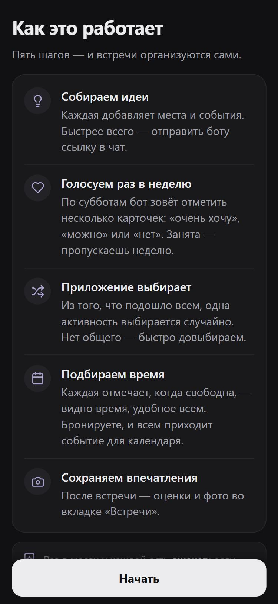 | 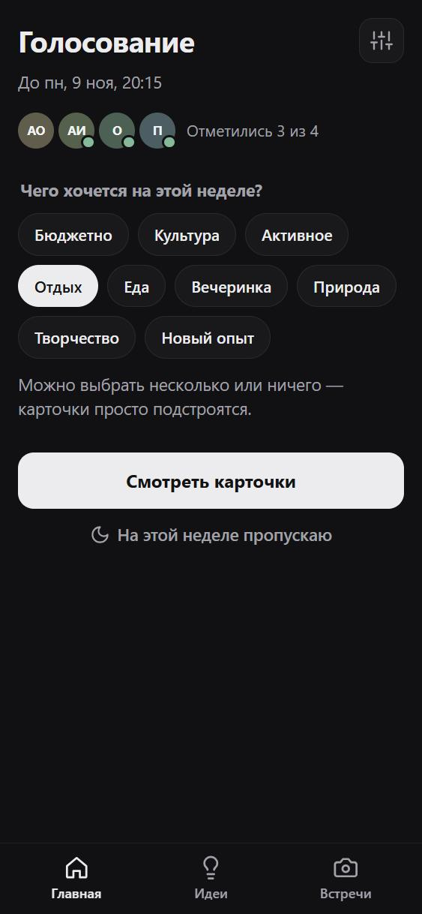 | 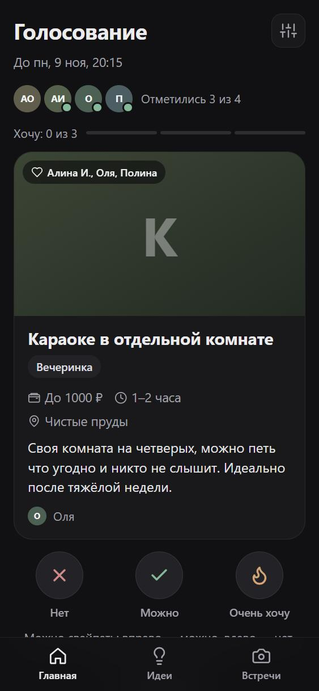 |
| **Довыбор** | **Частичные совпадения** | **Когда все свободны** |
| 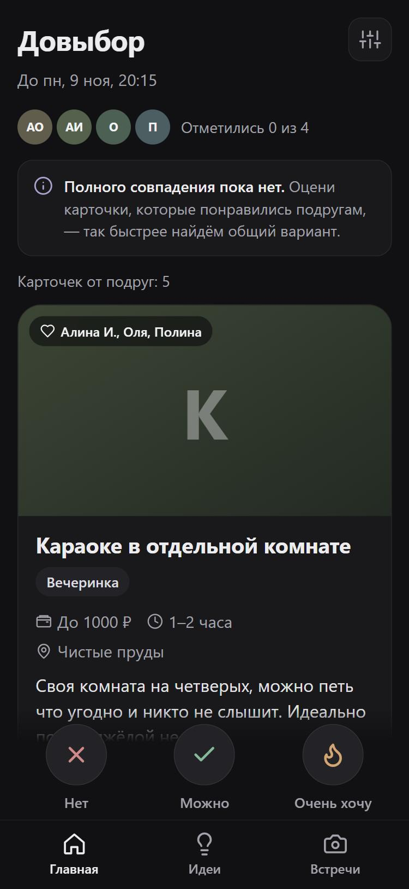 | 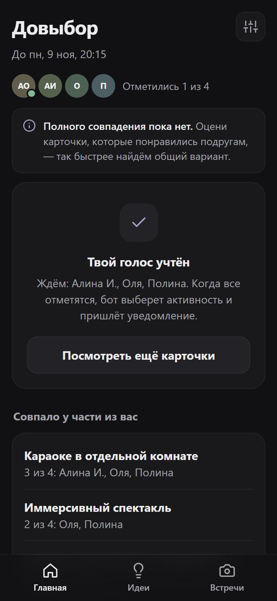 | 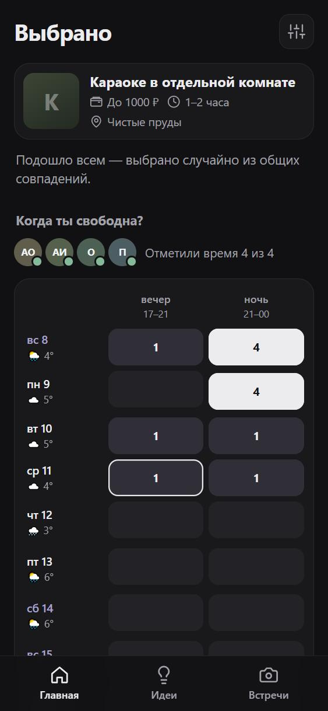 |
| **Лучшее время** | **Встреча назначена** | **Идеи** |
| 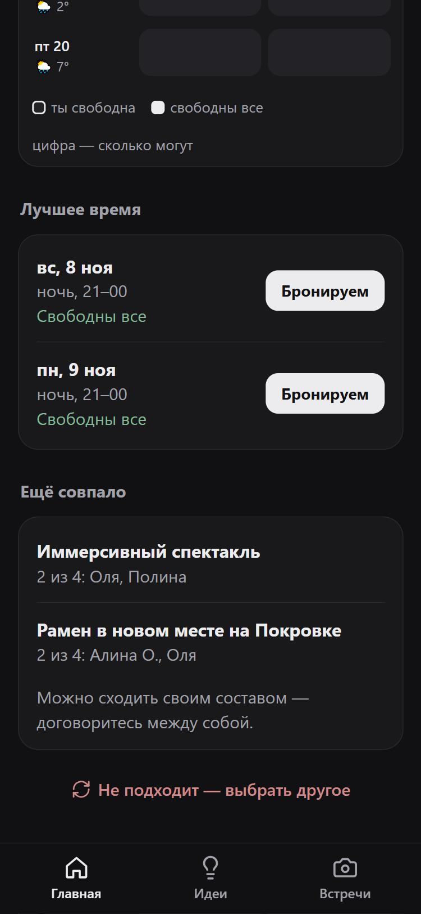 | 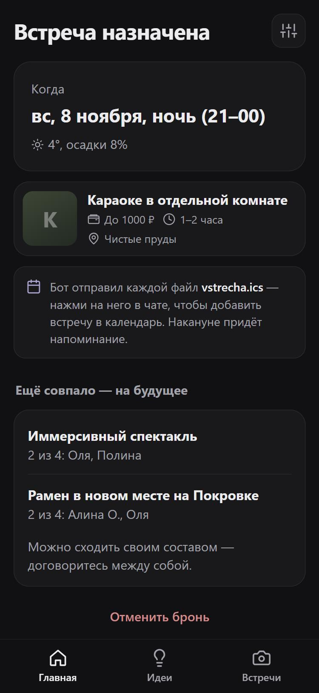 | 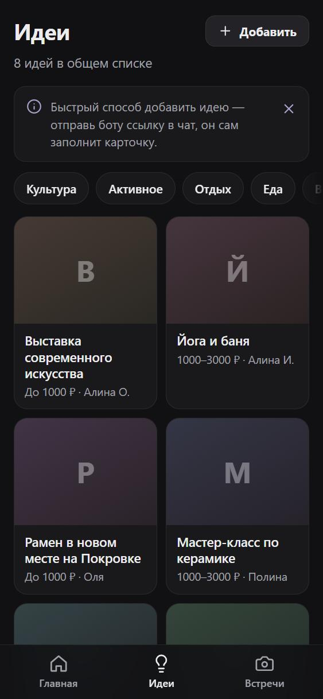 |
| **Новая идея** | **Фото карточки** | **Встречи** |
| 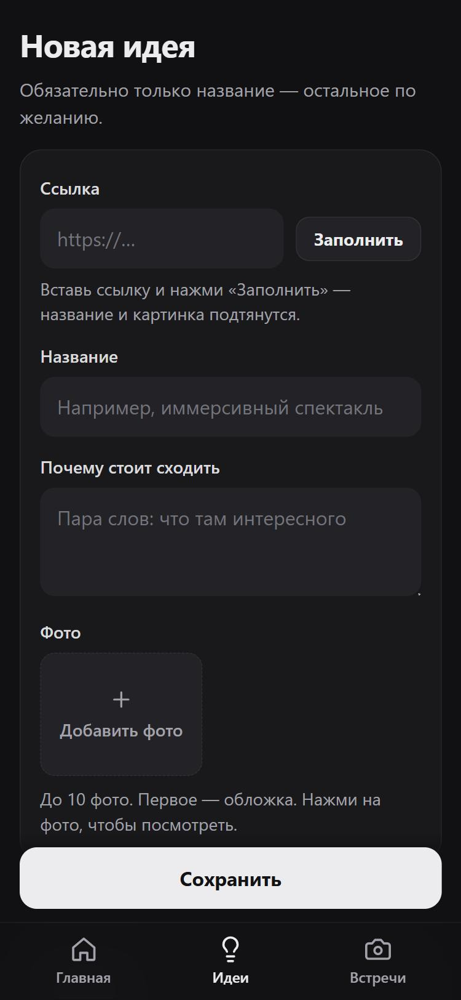 | 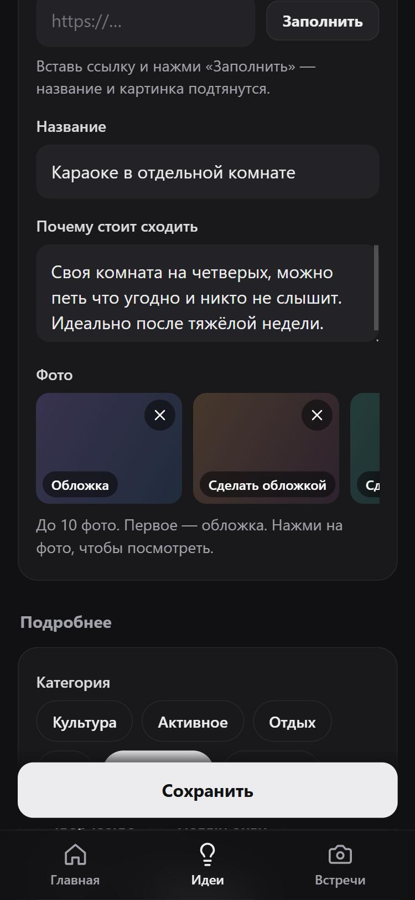 | 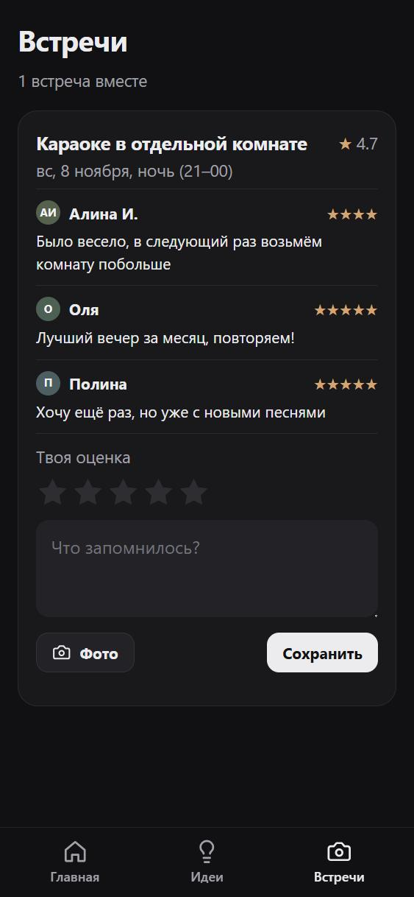 |

Тёмная тема по умолчанию; в настройках есть светлая и «как в Telegram».

## Как устроен цикл

1. **Идеи.** Карточка: до 10 фото (листаются, открываются на весь экран), ссылка, «почему круто», теги, бюджет, длительность, время суток, район, «на улице», «нужна бронь», «доступно до», точная дата (для концертов). Можно просто отправить боту ссылку — он вытащит название и картинку, сделает черновик и даст кнопку, которая открывает именно эту карточку.
2. **Суббота, 11:00.** Бот в личке зовёт голосовать (или кто-то жмёт «Начать выбор» / `/new`). Режим «каждую неделю» или «раз в 2 недели» — в настройках.
3. **Настроение недели** (бюджетно, отдых, активное…) и **пас** на неделю.
4. **Колода, а не 100 карточек.** Каждой показываются карточки по одной: «очень хочу» / «можно» / «нет» (или свайпом). Сначала идут те, что уже понравились подругам, подходят под настроение, новые или скоро исчезнут. Хватит 3 «хочу» или 10 карточек.
5. **Выбор.** Из того, что ок всем участвующим, выбирается случайное (с весом: «очень хочу» = 2, и чуть ниже шанс у той, чьи идеи недавно выигрывали). Раз в месяц у каждой есть джокер.
6. **Нет общего совпадения → довыбор.** Показываем, что совпало у части («Караоке — 3 из 4: Алина О., Оля, Полина» — можно сходить своим составом), а общую активность довыбираем: каждой показываются карточки, которые понравились остальным. Если и так нет — берём лучшее, против которого никто не голосовал.
7. **Время.** Сетка на 2 недели (утро/день/вечер/ночь) с прогнозом погоды, учитывает «доступно до» и время суток карточки. Видно, сколько подруг свободны; кнопка «Бронируем». Если нужна бронь — бот назначает, кто бронирует (по очереди).
8. **Бронь.** Всем приходит сообщение и `.ics` для календаря; накануне — напоминание с погодой.
9. **После.** Оценки, комментарии и фотки во вкладке «Встречи»; место уходит из колоды (можно вернуть).

Дедлайн голосования — воскресенье 20:00 (или 48 часов при ручном старте), на довыбор — ещё сутки. Напоминания: тем, кто не проголосовал; тем, кто не отметил время; в среду — если вы не виделись 2+ недели.

## Запуск

1. В [@BotFather](https://t.me/BotFather): `/newbot` → получить токен.
2. На сервере:
   ```bash
   cd ~/kuda-shodim
   cp .env.example .env   # вписать BOT_TOKEN и INVITE_CODE
   docker compose up -d --build
   docker compose logs -f app   # ждём "public url: https://….trycloudflare.com" и "bot started"
   ```
3. Каждая подруга открывает бота, жмёт Start и присылает код приглашения.

Адрес `*.trycloudflare.com` меняется при перезапуске — бот сам обновляет кнопку «Открыть». Если появится свой домен, впишите его в `PUBLIC_URL`.

Данные (SQLite и фото) лежат в `./data`. Бэкап: скопировать эту папку.

## Разработка

Node 20/22, без сборки фронтенда. Локально: `DEV_AUTH=1 INVITE_CODE=test npm start`, открыть `http://localhost:3000/?dev=1:Алина`.
Сквозной тест API: `BASE=http://localhost:3000 node test/e2e.mjs` (на чистой базе).

- `src/logic.js` — раунды, колода, выбор, слоты
- `src/bot.js` — бот, тексты уведомлений, туннель
- `src/scheduler.js` — суббота, дедлайны, напоминания
- `src/api.js` — HTTP API и проверка Telegram initData
- `public/` — миниапп
- `docs/screenshots/` — скриншоты для README (демо-данные)

Ссылки из бота на конкретный экран передают путь в `?r=…`, а не в `#…`: Telegram при запуске миниаппа занимает `#hash` своими параметрами.
